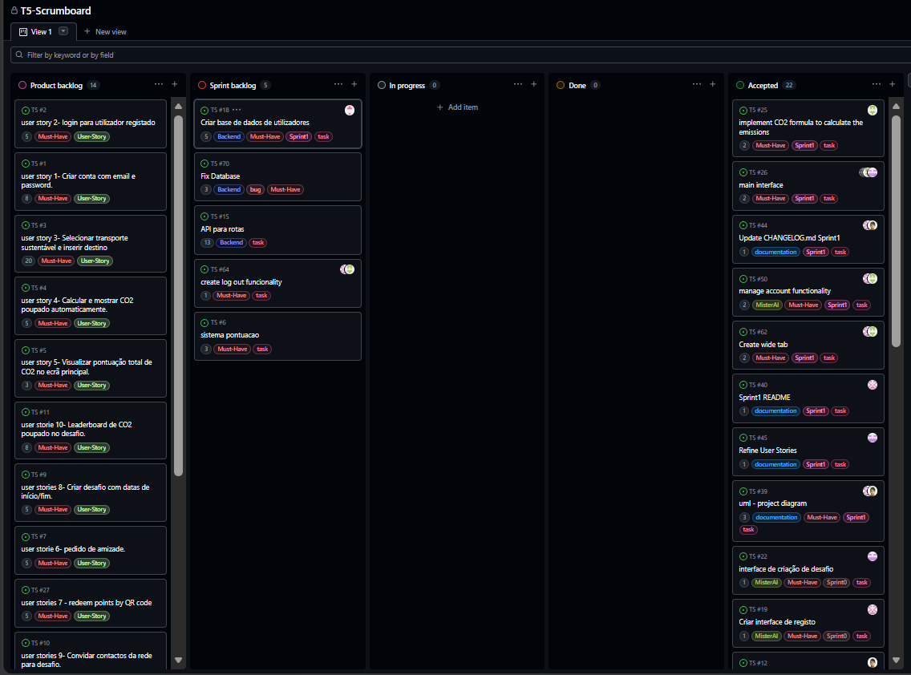
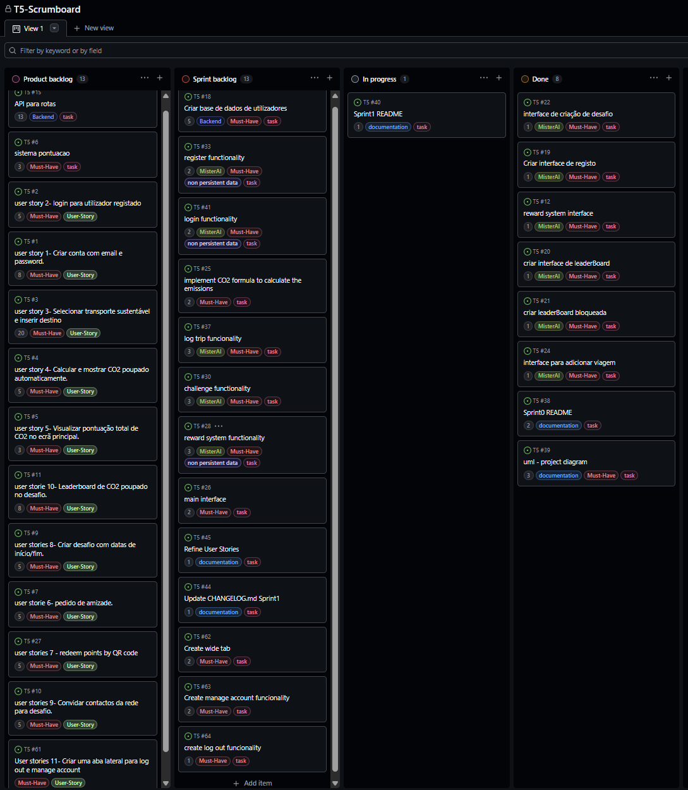
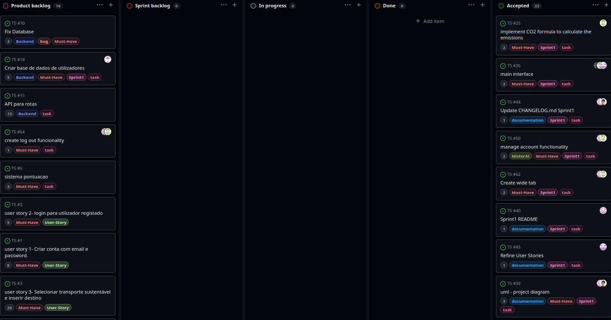
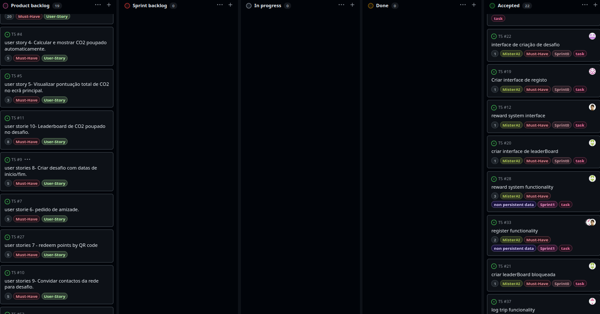
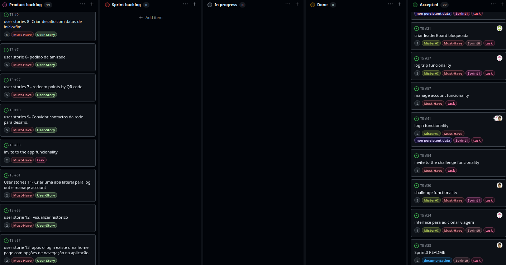
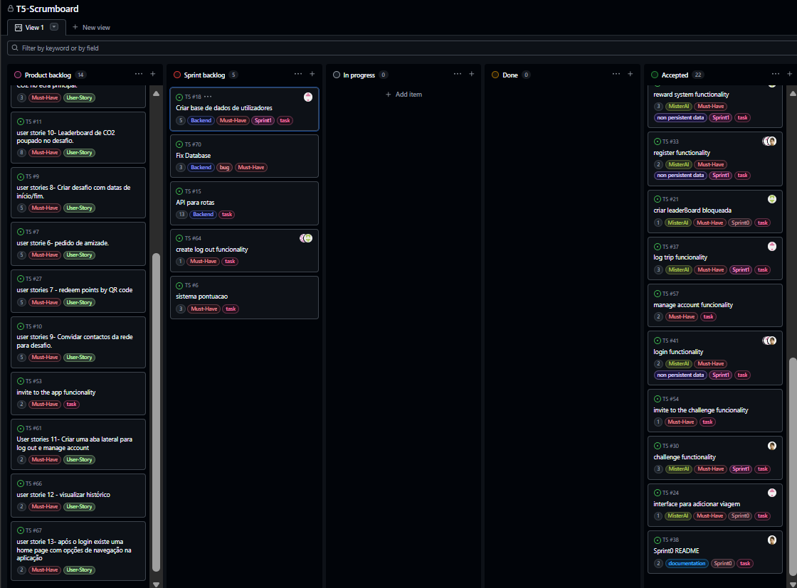
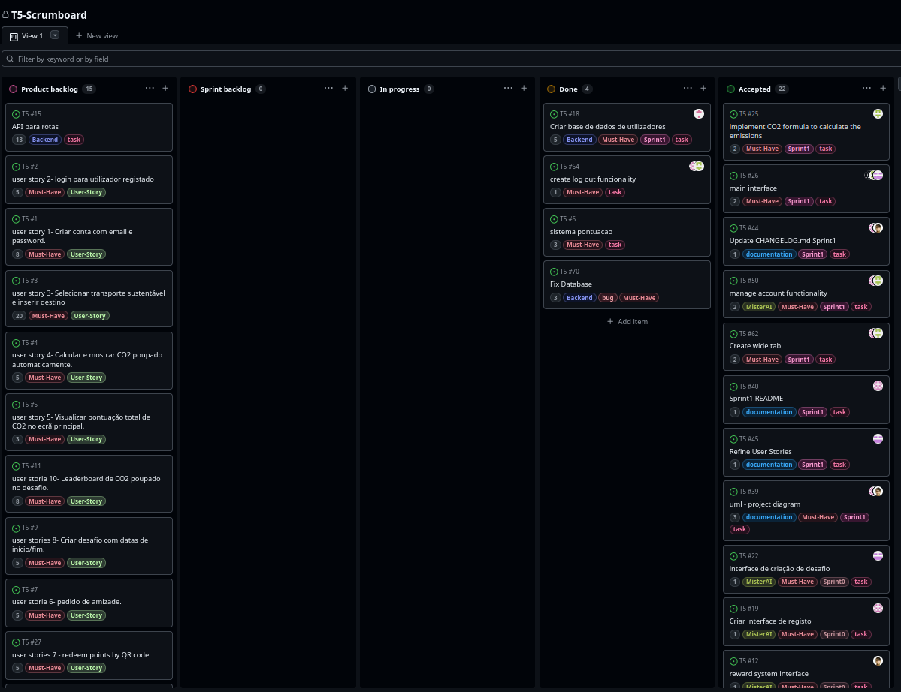
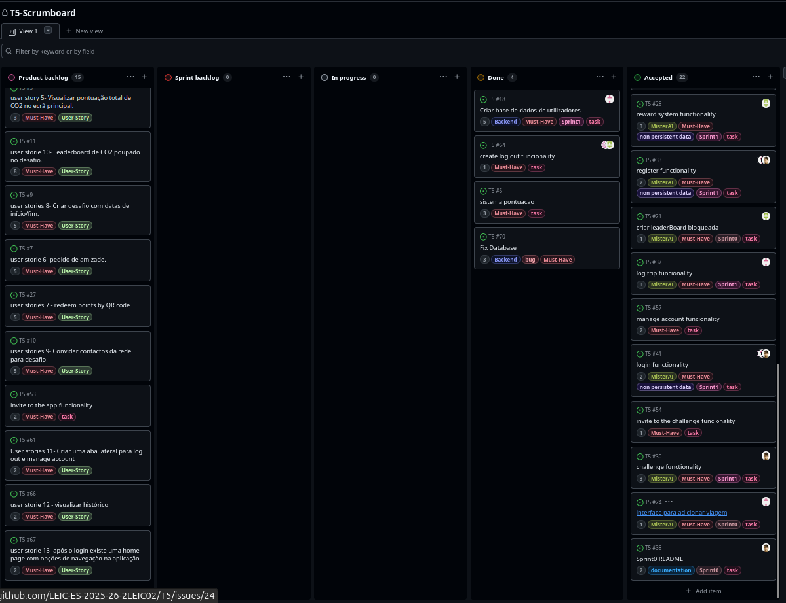

# CarbonCampus Development Report

Welcome to the documentation of **CarbonCampus**!

This Software Development Report, tailored for LEIC-ES-2025-26, provides comprehensive details about **CarbonCampus**, starting from a high-level vision and going into low-level implementation decisions.

It is organised by the following activities:

- Business modeling
  - Product Vision
  - Features and Assumptions
- Requirements
  - User stories
  - Domain model
  - User interfaces
- Architecture and Design
  - Logical architecture
  - Physical architecture
  - Functional prototype
- Project management
  - Sprint 0
  - Sprint 1
  - Sprint 2
  - Sprint 3
  - Final Release

Contributions are expected to be made exclusively by the initial team, but we may open them to the community, after the course, in all areas and topics: requirements, technologies, development, experimentation, testing, etc.

## Development Environment

This project is an Expo React Native app. The instructions below describe the tools, versions, and commands used by the team.

### Prerequisites

- Node.js LTS (18 or newer)
- npm (bundled with Node.js)
- Expo CLI (installed automatically via `npx expo`)
- Android Studio (for Android emulator) or Xcode (for iOS simulator, macOS only)

### Setup

1. Install dependencies:

   ```bash
   npm install
   ```

2. Start the development server:

   ```bash
   npm run start
   ```

3. Run on a target platform:

   ```bash
   npm run android
   npm run ios
   npm run web
   ```

### Tooling

- Linting: `npm run lint`
- TypeScript: configured via [tsconfig.json](tsconfig.json)
- ESLint: configured via [eslint.config.js](eslint.config.js)

## Coding Standards and Guidelines

- TypeScript is the default language; avoid `any` unless justified.
- Components live in [components](components/) and screens in [app](app/).
- Keep UI strings in English unless a screen is explicitly localized.
- Use existing hooks in [hooks](hooks/) before adding new ones.
- Run `npm run lint` before opening a PR.

## Responsible Use of Agentic AI

We document and label AI usage to keep it transparent and auditable.

- Tools used: GitHub Copilot (GPT-5.2-Codex).
- Prompts used: stored in this section as a brief summary when applicable.
- AI-generated code is committed separately and labeled with the prefix "MisterAI" in the commit message.
- All AI outputs are reviewed and tested by a team member before merging.

---

## Business Modelling

The app we propose, **CarbonCampus**, has the objective to reduce the carbon footprint of university students. The intense use of cars for short campus commutes is a leading cause in localized pollution. However, one way of limiting that is through the increased utilization of eco-friendly transport like cycling or walking. That way, if 5 students choose to walk to their faculty instead of driving, they significantly lower emissions.

The biggest issue with that is that students might lack the social motivation or feedback to change their habits, making it difficult to feel the impact of their choices. That's where our app steps in. We can connect students and allow them to compete in green challenges, making it a great way to avoid excessive usage of cars, earn rewards, and save the planet.

But a student might find it disadvantageous to change their routine without a tangible incentive. That's where we implement a gamified ecosystem.

Business modeling in software development involves defining the product's vision, understanding market needs, aligning features with user expectations, and setting the groundwork for strategic planning and execution.

### Product Vision

**CarbonCampus - Full Product Vision**

The app **CarbonCampus** aims to transform the way students commute by reducing unnecessary car usage and promoting sustainable habits. Today, many student trips are under-optimized, often relying on solo car travel while contributing to traffic, high fuel consumption, and campus pollution. CarbonCampus addresses this by connecting peers through competitive challenges and transparent impact tracking, creating an efficient, eco-friendly way to move through the university.

For participants, CarbonCampus provides gamified rewards, reducing environmental impact and giving easy access to a community of like-minded individuals. For all users, the app ensures trust through verified academic tags, course-based rankings, and secure social interaction. Finally, by implementing a point system and a leaderboard, we are using basic human psychology to encourage competition and therefore the usage of the app. By making sustainability easy, safe, and rewarding, CarbonCampus encourages more people to choose green alternatives over solo car trips.

Our vision is to create a community-driven ecosystem where daily habits meet sustainability: fewer cars on the road, lower emissions, more cost-effective travel, and the opportunity to connect with new people. Ultimately, CarbonCampus doesn't just track points - it moves society closer to a greener, smarter, and more connected future.

**Key Features Driving This Vision:**

- Smart impact calculation to minimize the perceived effort for users.
- Verified academic tags, ratings, and challenge history for safety and trust.
- Automated point-sharing for groups to reward team efforts fairly.
- Real-time sustainability statistics and notifications for convenience.
- Community-building features, such as peer invites and shared challenges, to foster trust and engagement.
- A point system that encourages app utilization.

### Features and Assumptions

- **Sustainability Dashboard:** Depending on the profile of the user (active or passive participant), the dashboard highlights the best way to maximize CO2 savings and earn the most points.
- **Registration System:** Basic account management to keep track of the users and their academic affiliations.
- **Competitiveness Framework:** The points allow for competitive rankings and the acquisition of social badges for the profile.

## Requirements

### User Stories

Our requirements are documented as User Stories in our GitHub Project T5-Scrumboard. We followed the INVEST guidelines to ensure each story is Independent, Negotiable, Valuable, Estimable, Small, and Testable.

| ID   | User Story | Priority (MoSCoW) | Effort (Fibonacci) |
| ---- | ---------- | ----------------- | ------------------ |
| US1  | Como visitante, quero criar uma conta utilizando o meu endereço de email e uma palavra-passe, para poder guardar o meu histórico de viagens e a minha pontuação. | Must-have | 8 |
| US2  | Como utilizador registado, quero fazer o login na aplicação, para aceder aos meus dados e aos meus desafios em curso. | Must-have | 5 |
| US3  | Como utilizador, quero selecionar um meio de transporte sustentável (ex: bicicleta, transporte público, a pé) e inserir a distância que percorri, para registar uma deslocação. | Must-have | 20 |
| US4  | Como utilizador, quero que a aplicação calcule e mostre automaticamente a quantidade de CO2 (em kg ou gramas) que poupei ao registar a viagem, para validar a minha ação. | Must-have | 5 |
| US5  | Como utilizador, quero visualizar a minha pontuação total de CO2 poupado no ecrã principal, para ter noção do meu impacto ambiental acumulado. | Must-have | 3 |
| US6  | Como utilizador, quero pesquisar outros utilizadores inserindo o seu endereço de email, para lhes enviar um pedido de ligação/amizade. | Must-have | 5 |
| US7  | Como utilizador, quero aceitar ou rejeitar convites de outros utilizadores, para gerir quem pertence à minha rede. | Must-have | 5 |
| US8  | Como utilizador, quero criar um novo desafio com uma data de início e uma data de fim estipuladas, para definir o período da competição. | Must-have | 5 |
| US9  | Como criador de um desafio, quero selecionar contactos da minha rede e enviar-lhes um convite, para que entrem na competição. | Must-have | 5 |
| US10 | Como participante num desafio ativo, quero ver uma tabela classificativa (leaderboard) ordenada pela quantidade de CO2 poupado durante o tempo do desafio, para verificar em que posição me encontro face aos restantes concorrentes. | Must-have | 8 |

### Requirements Quality (DoR)

Each User Story in our backlog includes:

- **Gherkin Scenarios:** Clear "Given/When/Then" acceptance tests to confirm requirements are met.
- **User Interface Mockups:** High-fidelity drafts attached to each issue to guide frontend development.
- **Estimation:** Value (Business Priority) and Effort (Story Points) defined by the whole team.
- **Refinement:** Larger stories were broken down into technical Tasks to be "immediately actionable" as per the LEIC-ES Dashboard criteria.

### Testing Artifacts

The project includes automated and manual testing artifacts for implemented stories:

- **Acceptance tests:** `__tests__/LogTripScreen.test.tsx`, `__tests__/register.test.tsx`, `__tests__/login.test.tsx`, `__tests__/invites.test.tsx`, `__tests__/challenge.test.tsx`, `__tests__/rankings.test.tsx`, `__tests__/history.test.tsx`, `__tests__/home.test.tsx`, `__tests__/rewardScreen.test.tsx`, `__tests__/register-trip.test.tsx`, `__tests__/index-redirect.test.tsx`
- **Unit tests (main functional requirements):** `__tests__/unit.functional-requirements.test.ts`, `__tests__/unit.trips-context.test.tsx`
- **Integration tests (component integrations):** `__tests__/integration.functional-flows.test.tsx`
- **User acceptance tests (UAT plan):** `docs/testing/UAT.md`
- **Defect tracking and verification:** `docs/testing/defect-log.md`

### Database Setup

- **Firebase/Firestore setup guide:** `docs/firebase-setup.md`
- **Environment template:** `.env.example`

### Quick Start (development)

Follow these steps to get a development environment running locally:

1. (Optional) Install Expo CLI and Firebase CLI globally:

```bash
npm install -g expo-cli
npm install -g firebase-tools
```

2. Clone the repository and install dependencies:

```bash
git clone <your-repo-url>
cd T5
npm install
```

3. Configure environment variables:

- Copy `.env.example` to `.env` and fill in your Firebase credentials (or use the provided local emulator settings).

```bash
cp .env.example .env
# then edit .env
```

4. (Optional) Start the Firestore emulator locally (recommended for safe development):

```bash
npm run firebase:login      # once, to authenticate the Firebase CLI
npm run firebase:emulators  # starts the Firestore emulator
```

5. Start the app with Expo:

```bash
npm run start
# or run directly on a platform
npm run android
npm run ios
npm run web
```

6. Run tests locally (see Testing & Coverage below).

---

### Running Tests & Coverage

The project includes unit, integration and acceptance tests. Use the npm scripts defined in `package.json`:

- Run the full test suite:

```bash
npm run test
```

- Run tests with coverage report (Jest):

```bash
npm run test -- --coverage
```

- Run linting:

```bash
npm run lint
```

CI runs linting and the test suite automatically on PRs.

Troubleshooting:
- If tests that interact with Firebase or native modules fail locally, ensure `NODE_ENV=test` is set (Jest does this) and emulators are either enabled or mocked as appropriate.
- For flaky UI tests, try running with `--runInBand` or increasing Jest timeouts in `jest.setTimeout` when debugging locally.

---

### Device & Emulator Notes (physical devices)

- Android emulator: use Android Studio AVD or `expo start --android`. The Android emulator loopback host is `10.0.2.2` - the code handles this automatically, but when running on a physical Android device you must set `EXPO_PUBLIC_FIREBASE_EMULATOR_MOBILE_HOST` to your machine LAN IP.

- iOS simulator: uses local loopback (`127.0.0.1`) by default; physical iOS devices require tunnel or LAN configuration via Expo.

- Expo Tunnel: when working across devices and teammates, using the Expo "tunnel" mode can simplify connectivity but may have performance implications. Use `npm run start` and choose the Tunnel option in the Expo DevTools if needed.

---

## Architecture and Design

### Logical Architecture

The user interacts through the User Interface for visual elements and interactions, with the Business Logic layer handling carbon calculations and social logic, and external services for location tracking. Data storage and retrieval are handled by local persistence and eventually a database schema.

### Physical Architecture

Each user interacts with the application via their mobile device. The application accesses external machines to retrieve necessary data, such as mapping services and the central database.

### Functional Prototype

To help validate all architectural, design, and technological decisions made, we implemented a functional prototype - a thin vertical slice of the system.

We implemented the Trip Logging and Friend Invite modules. The prototype demonstrates a screen where users can search for peers via unique tags and log their daily commutes, showing the immediate update of points on the dashboard.

## Project Management

To ensure a smooth, transparent, and iterative development process for **CarbonCampus**, our team adopted Agile methodologies, specifically focusing on the Scrum framework. We utilize a set of practices and tools to plan, implement, monitor, and control our software project effectively.

### Continuous Review of Design Artifacts

We review and refine design artifacts when needed to keep requirements, models, and code consistent:

- User Stories and acceptance criteria are updated in the GitHub Project during refinement and after sprint reviews.
- UI mockups are revised when flows or screens change; updates are reflected in the implementation.
- Architectural notes are adjusted when backend or navigation decisions change (see Sprint 2 notes and `docs/firebase-setup.md`).

Our project management workflow is structured around the following key areas:

- **Backlog Management:** We manage both our Product Backlog and Sprint Backlogs using our GitHub Projects board. This board acts as our single source of truth for tracking User Stories, Tasks, estimations, and priorities.
- **Release Management:** We align our releases with the end of our Sprints. Code increments are systematically tagged (e.g., `v1.0.0` for Sprint 1) in our GitHub repository to mark stable milestones. See `CHANGELOG.md` for the full release notes.
- **Sprint Planning & Retrospectives:**
  - **Plans:** At the beginning of each Sprint, we select User Stories and break them down into actionable tasks.
  - **Retrospectives:** At the end of every Sprint, the team inspects our workflow. We address what we did well, what to do differently, open puzzles, and future improvements.

### Sprint 1

The detailed notes from our Sprint 1 Planning and Retrospective can be found in our dedicated documentation. During this sprint, we successfully established the foundational UI and the social networking logic.

### Sprint 1 Scrumboard

> **Data do registo:** 20 de abril de 2026  
> **Estado:** Finalizada



*Nota: Esta imagem reflete a distribuição das User Stories e tarefas entre as colunas "To Do", "In Progress" e "Done" antes da conclusão formal da sprint.*

Final Sprint1







### Sprint 2

Focused on transforming the application from a prototype to a cloud-backed increment. The sprint introduced Firebase as the primary backend for authentication and persistence, and connected the app features to Firestore.

Key accomplishments in Sprint 2 (v1.1.0):

- Firebase integration and emulator support (`services/firebase.ts`, `docs/firebase-setup.md`).
- Authentication flow with Firebase Auth (`services/auth.service.ts`).
- User profile persistence and public leaderboard synchronization (`services/users.service.ts`).
- Trips persistence with automatic points update and leaderboard write-through (`services/trips.service.ts`).
- Invites and challenge invite persistence (`services/invites.service.ts`, `services/challenges.service.ts`).
- Cloud-based leaderboard aggregation and ranking (`services/leaderboard.service.ts`).
- Documentation for local emulator and cloud setup (`docs/firebase-setup.md`).
- Tests extended to cover the new cloud flows and edge cases.

These items are listed in full in `CHANGELOG.md` under `v1.1.0`.

### Sprint 2 Scrumboard

> **Data do registo:** 12 de maio de 2026  
> **Estado:** Em progresso




*Nota: Estas imagens refletem o estado do Scrumboard no início do Sprint 2, com a distribuição das User Stories e tarefas entre as colunas "Product backlog", "Sprint backlog", "In progress", "Done" e "Accepted".*





*Nota: Estas imagens refletem o estado do Scrumboard no fim do Sprint 2, com a distribuição das User Stories e tarefas entre as colunas "Product backlog", "Sprint backlog", "In progress", "Done" e "Accepted".*

### Final Release

[Placeholder for final evaluation notes]

## Tech Stack

- React Native + Expo
- `expo-router` for navigation
- Firebase (Auth + Firestore) for backend persistence
- Jest + React Native Testing Library for tests
- GitHub Actions for CI/CD
- AsyncStorage for mobile persistence fallback

## Backend / Firebase (Executive summary)

The Sprint 2 increment introduced Firebase to provide authentication and durable storage for the app. The implementation includes:

- `services/firebase.ts`: initialization, emulator support and environment-driven configuration.
- `services/auth.service.ts`: register/login/logout and auth state handling.
- `services/users.service.ts`: create/update/fetch user profiles, leaderboard sync.
- `services/trips.service.ts`: save and fetch trips, update user points and leaderboard.
- `services/invites.service.ts` and `services/challenges.service.ts`: persist social interactions and invites.
- `services/leaderboard.service.ts`: compute rankings using Firestore entries as source-of-truth.

Developers can follow `docs/firebase-setup.md` to run the Firebase Emulator Suite locally or connect to a real Firebase project. Use `.env.example` as template for required environment variables.

## Testing & Quality

- Unit, integration and acceptance tests are present in `__tests__/` and executed through CI.
- The CI pipeline (`.github/workflows/ci.yml`) runs linting and test suites on every PR.
- Test coverage reports are generated as part of the CI; see `CHANGELOG.md` and CI logs for historical values.
- Defects and verification steps are recorded in `docs/testing/defect-log.md` and UAT scenarios are in `docs/testing/UAT.md`.

## Release Management & Tags

Releases are documented in `CHANGELOG.md`. Current stable tags:

- `v0.1.0` - Sprint 0
- `v1.0.0` - Sprint 1
- `v1.1.0` - Sprint 2

When creating a new release, ensure the changelog and sprint retrospective are updated and the CI pipeline builds and publishes artifacts (APK) on tagged releases.

## Known limitations & Next steps

- Emulator vs cloud: decide a consistent approach for team members (emulator for local dev, cloud for team-wide shared data).
- GPS automation: still debated - Sprint 3 may target optional GPS tracking with privacy-conscious defaults.
- Persistence stability: continue improving error handling and retry strategies for offline/online transitions.

## Links & References

- `CHANGELOG.md` - release notes and important changes
- `SprintPlanningRetrospectives.md` - sprint planning and retrospectives
- `docs/firebase-setup.md` - Firebase setup and emulator instructions
- `docs/testing/UAT.md` - user acceptance tests
- `docs/testing/defect-log.md` - tracked defects and fixes

## DevOps Status

[](https://github.com/lfscastanheira/LEIC-ES-2025-26-2LEIC02/actions/workflows/ci.yml)

[](https://github.com/lfscastanheira/LEIC-ES-2025-26-2LEIC02/actions/workflows/build-apk.yml)# CarbonCampus Development Report

Welcome to the documentation of **CarbonCampus**!

This Software Development Report, tailored for LEIC-ES-2025-26, provides comprehensive details about **CarbonCampus**, starting from a high-level vision and going into low-level implementation decisions.

It is organised by the following activities:

- Business modeling
  - Product Vision
  - Features and Assumptions
- Requirements
  - User stories
  - Domain model
  - User interfaces
- Architecture and Design
The project includes unit, integration and acceptance tests. Use the npm scripts defined in `package.json`:

- Run the full test suite:

```bash
npm run test
```

- Run tests with coverage report (Jest):

```bash
npm run test -- --coverage
```

- Run linting:

```bash
npm run lint
```

CI runs linting and the test suite automatically on PRs.

Troubleshooting:
- If tests that interact with Firebase or native modules fail locally, ensure `NODE_ENV=test` is set (Jest does this) and emulators are either enabled or mocked as appropriate.
- For flaky UI tests, try running with `--runInBand` or increasing Jest timeouts in `jest.setTimeout` when debugging locally.

---

### Device & Emulator Notes (physical devices)

- Android emulator: use Android Studio AVD or `expo start --android`. The Android emulator loopback host is `10.0.2.2` — the code handles this automatically, but when running on a physical Android device you must set `EXPO_PUBLIC_FIREBASE_EMULATOR_MOBILE_HOST` to your machine LAN IP.

- iOS simulator: uses local loopback (`127.0.0.1`) by default; physical iOS devices require tunnel or LAN configuration via Expo.

- Expo Tunnel: when working across devices and teammates, using the Expo "tunnel" mode can simplify connectivity but may have performance implications. Use `npm run start` and choose the Tunnel option in the Expo DevTools if needed.

---

## Architecture and Design

### Logical Architecture

The user interacts through the User Interface for visual elements and interactions, with the Business Logic layer handling carbon calculations and social logic, and external services for location tracking. Data storage and retrieval are handled by local persistence and eventually a database schema.

### Physical Architecture

Each user interacts with the application via their mobile device. The application accesses external machines to retrieve necessary data, such as mapping services and the central database.

### Functional Prototype

To help validate all architectural, design, and technological decisions made, we implemented a functional prototype - a thin vertical slice of the system.

We implemented the Trip Logging and Friend Invite modules. The prototype demonstrates a screen where users can search for peers via unique tags and log their daily commutes, showing the immediate update of points on the dashboard.

## Project Management

To ensure a smooth, transparent, and iterative development process for **CarbonCampus**, our team adopted Agile methodologies, specifically focusing on the Scrum framework. We utilize a set of practices and tools to plan, implement, monitor, and control our software project effectively.

Our project management workflow is structured around the following key areas:

- **Backlog Management:** We manage both our Product Backlog and Sprint Backlogs using our GitHub Projects board. This board acts as our single source of truth for tracking User Stories, Tasks, estimations, and priorities.
- **Release Management:** We align our releases with the end of our Sprints. Code increments are systematically tagged (e.g., `v1.0.0` for Sprint 1) in our GitHub repository to mark stable milestones. See `CHANGELOG.md` for the full release notes.
- **Sprint Planning & Retrospectives:**
  - **Plans:** At the beginning of each Sprint, we select User Stories and break them down into actionable tasks.
  - **Retrospectives:** At the end of every Sprint, the team inspects our workflow. We address what we did well, what to do differently, open puzzles, and future improvements.

### Sprint 1

The detailed notes from our Sprint 1 Planning and Retrospective can be found in our dedicated documentation. During this sprint, we successfully established the foundational UI and the social networking logic.


### Sprint 1 Scrumboard

> **Data do registo:** 20 de abril de 2026  
> **Estado:** Finalizada


*Nota: Esta imagem reflete a distribuição das User Stories e tarefas entre as colunas "To Do", "In Progress" e "Done" antes da conclusão formal da sprint.*

Final Sprint1


### Sprint 2

Focused on transforming the application from a prototype to a cloud-backed increment. The sprint introduced Firebase as the primary backend for authentication and persistence, and connected the app features to Firestore.

Key accomplishments in Sprint 2 (v1.1.0):

- Firebase integration and emulator support (`services/firebase.ts`, `docs/firebase-setup.md`).
- Authentication flow with Firebase Auth (`services/auth.service.ts`).
- User profile persistence and public leaderboard synchronization (`services/users.service.ts`).
- Trips persistence with automatic points update and leaderboard write-through (`services/trips.service.ts`).
- Invites and challenge invite persistence (`services/invites.service.ts`, `services/challenges.service.ts`).
- Cloud-based leaderboard aggregation and ranking (`services/leaderboard.service.ts`).
- Documentation for local emulator and cloud setup (`docs/firebase-setup.md`).
- Tests extended to cover the new cloud flows and edge cases.

These items are listed in full in `CHANGELOG.md` under `v1.1.0`.

### Sprint 2 Scrumboard

> **Data do registo:** 12 de maio de 2026  
> **Estado:** Em progresso


*Nota: Estas imagens refletem o estado do Scrumboard no início do Sprint 2, com a distribuição das User Stories e tarefas entre as colunas "Product backlog", "Sprint backlog", "In progress", "Done" e "Accepted".*


*Nota: Estas imagens refletem o estado do Scrumboard no fim do Sprint 2, com a distribuição das User Stories e tarefas entre as colunas "Product backlog", "Sprint backlog", "In progress", "Done" e "Accepted".*

### Final Release

[Placeholder for final evaluation notes]

## The T5 Development Team

- Afonso Vilas and up202403577@up.pt
- Martim Ferreira and up202403764@up.pt
- Guilherme Pinho and up202406596@up.pt
- Luís Castanheira and up202404122@up.pt
- Pedro Cunha and up202403358@up.pt

## Tech Stack

- React Native + Expo
- `expo-router` for navigation
- Firebase (Auth + Firestore) for backend persistence
- Jest + React Native Testing Library for tests
- GitHub Actions for CI/CD
- AsyncStorage for mobile persistence fallback

## Backend / Firebase (Executive summary)

The Sprint 2 increment introduced Firebase to provide authentication and durable storage for the app. The implementation includes:

- `services/firebase.ts`: initialization, emulator support and environment-driven configuration.
- `services/auth.service.ts`: register/login/logout and auth state handling.
- `services/users.service.ts`: create/update/fetch user profiles, leaderboard sync.
- `services/trips.service.ts`: save and fetch trips, update user points and leaderboard.
- `services/invites.service.ts` and `services/challenges.service.ts`: persist social interactions and invites.
- `services/leaderboard.service.ts`: compute rankings using Firestore entries as source-of-truth.

Developers can follow `docs/firebase-setup.md` to run the Firebase Emulator Suite locally or connect to a real Firebase project. Use `.env.example` as template for required environment variables.

## Testing & Quality

- Unit, integration and acceptance tests are present in `__tests__/` and executed through CI.
- The CI pipeline (`.github/workflows/ci.yml`) runs linting and test suites on every PR.
- Test coverage reports are generated as part of the CI; see `CHANGELOG.md` and CI logs for historical values.
- Defects and verification steps are recorded in `docs/testing/defect-log.md` and UAT scenarios are in `docs/testing/UAT.md`.

## Release Management & Tags

Releases are documented in `CHANGELOG.md`. Current stable tags:

- `v0.1.0` - Sprint 0
- `v1.0.0` - Sprint 1
- `v1.1.0` - Sprint 2

When creating a new release, ensure the changelog and sprint retrospective are updated and the CI pipeline builds and publishes artifacts (APK) on tagged releases.

## Known limitations & Next steps

- Emulator vs cloud: decide a consistent approach for team members (emulator for local dev, cloud for team-wide shared data).
- GPS automation: still debated — Sprint 3 may target optional GPS tracking with privacy-conscious defaults.
- Persistence stability: continue improving error handling and retry strategies for offline/online transitions.

## Links & References

- `CHANGELOG.md` - release notes and important changes
- `SprintPlanningRetrospectives.md` - sprint planning and retrospectives
- `docs/firebase-setup.md` - Firebase setup and emulator instructions
- `docs/testing/UAT.md` - user acceptance tests
- `docs/testing/defect-log.md` - tracked defects and fixes

## DevOps Status

[](https://github.com/lfscastanheira/LEIC-ES-2025-26-2LEIC02/actions/workflows/ci.yml)

[](https://github.com/lfscastanheira/LEIC-ES-2025-26-2LEIC02/actions/workflows/build-apk.yml)

## The T5 Development Team

- Afonso Vilas and up202403577@up.pt
- Martim Ferreira and up202403764@up.pt
- Guilherme Pinho and up202406596@up.pt
- Luis Castanheira and up202404122@up.pt
- Pedro Cunha and up202403358@up.pt

